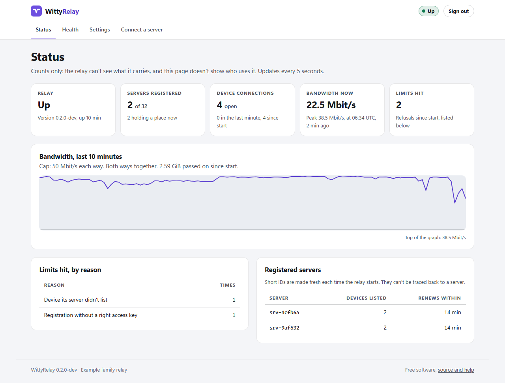
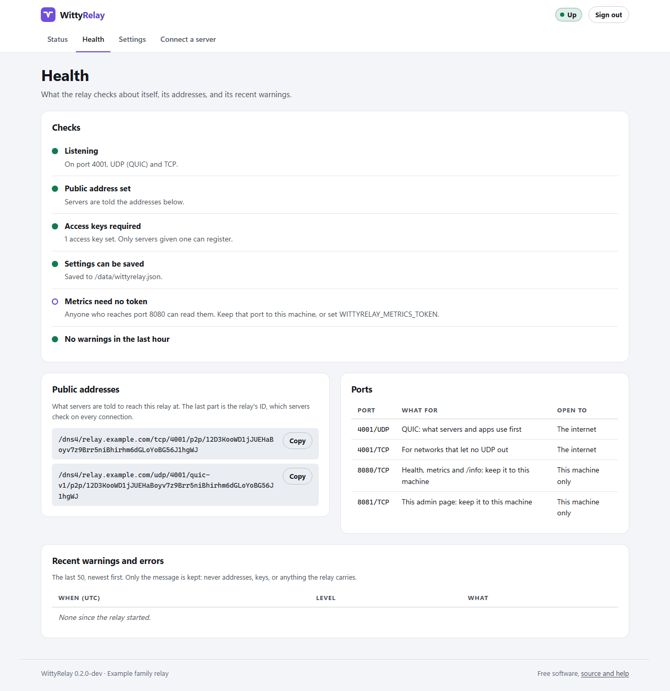
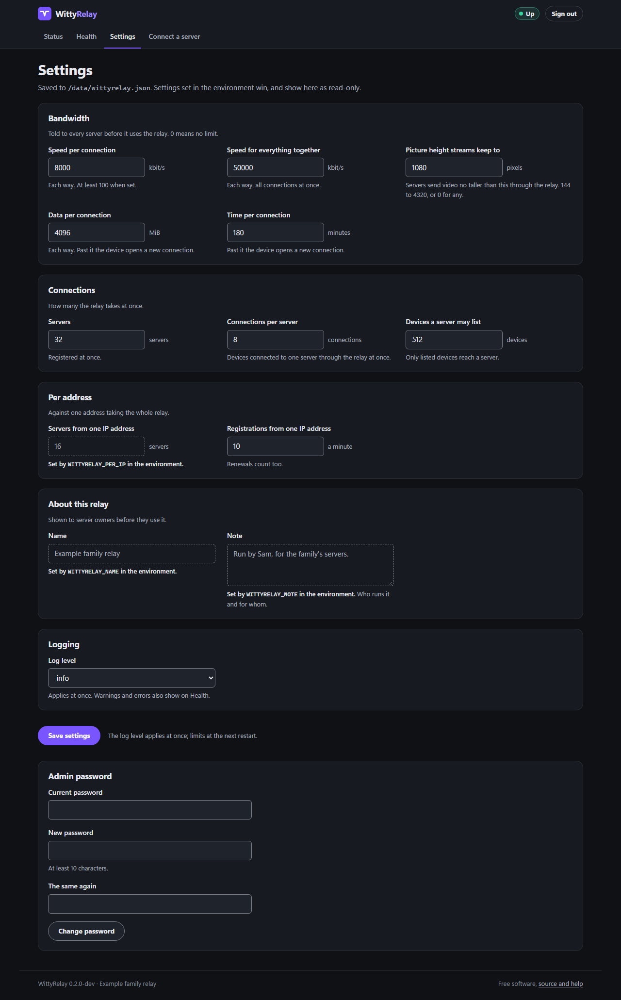
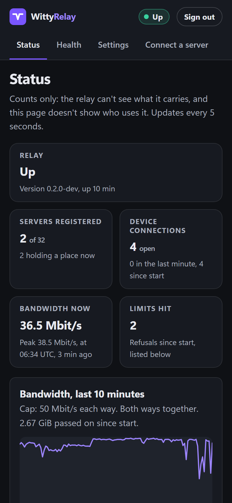

# The admin page

WittyRelay has a small web page for whoever runs it: how the relay is doing, its health, its limits, and how to point a WittyMediaServer at it. It's free, like the relay, and part of the same binary: no other service, no third-party scripts or fonts.



## Turning it on

It's **off** unless `WITTYRELAY_ADMIN` (or `admin.listen` in the JSON file) names an address to listen on.

| Where the relay runs | Set | Reach it at |
|---|---|---|
| Docker (the Compose file) | `WITTYRELAY_ADMIN: ":8081"` and the port `"127.0.0.1:8081:8081"` | `http://localhost:8081` on the relay's machine |
| Straight on a machine | `WITTYRELAY_ADMIN=127.0.0.1:8081` | `http://localhost:8081` on that machine |

In Docker the page listens on every interface **inside the container**, and the port mapping keeps it to `127.0.0.1` on the host. Don't publish it as plain `8081:8081`.

From another computer, use an SSH tunnel:

```bash
ssh -L 8081:localhost:8081 you@relay.example.com
```

then open `http://localhost:8081` there. Or put it behind a reverse proxy with HTTPS, and add the proxy's name to `WITTYRELAY_ADMIN_HOSTS` (any other name is refused, against DNS rebinding).

Signing in works only over HTTPS or from `localhost`: the session cookie is `Secure`, so a browser won't keep it on plain HTTP from another address. The page says so instead of failing quietly.

## The first password

The first time the page is on and has no password, the relay prints a one-time **setup token** in its log:

```bash
docker compose logs wittyrelay | grep "setup token"
```

Open the page, paste the token, and choose a password (10 characters or more). The token stops working once a password is set, and isn't printed again.

Or set the password from the command line, which also resets a forgotten one:

```bash
docker compose exec -T wittyrelay wittyrelay admin-password <<< 'a long new password'
```

The password is kept as an **argon2id** hash (19 MiB, 2 passes, a random salt) in `admin.json` in the data volume, next to the relay's key. Never the password itself.

## What it shows

| Page | What |
|---|---|
| **Status** | Up or not, version, uptime; servers registered and places held; device connections open, in the last minute and since start; bandwidth now and its peak; a graph of the last ten minutes; refusals by reason ("limits hit"); registered servers by short ID, with how many devices each listed and when it renews; the health servers are told (OK, Busy, Full or Starting, and the load); every connection open, in and out and still saying who it is, against the relay's budget, with memory in use; and **Limits per network**: servers from one network, connections from one address, registrations a minute and the pace of new connections, each with the busiest network or address now and how many are at the limit. Those are counted from addresses held in memory, and only the numbers reach the page |
| **Health** | Checks (listening, public address, access, whether settings can be saved, a restart waiting, recent warnings); the public addresses with Copy buttons; the ports and who they should be open to; the last 50 warnings and errors |
| **Settings** | Bandwidth caps, connection limits, per-address limits, the name and note servers are shown, the log level; the admin password |
| **Connect a server** | The steps: ports to open, access keys, where to paste the address on a WittyMediaServer, how to check it worked; the relay's addresses; a `docker-compose.yml` to start from |



### What it never shows

- **What the relay carries.** It can't read it anyway: it's encrypted between the app and the server.
- **Access keys, the metrics token, the setup token, the password or its hash.** The page says where keys are set, never what they are.
- **Who uses the relay.** No server names, peer IDs, devices or IP addresses: counts, and a short ID per registered server (`srv-3fa2c1`) made from a key that's new every time the relay starts, so it can't be matched to a server or followed from one run to the next.
- **Log lines in full.** Recent warnings keep only the message and a reason or error; addresses and anything else a log line carries are dropped.

## Settings



Settings are saved to the configuration file: the one named by `WITTYRELAY_CONFIG`, or `/config/wittyrelay.json` if it's there, or else `wittyrelay.json` in the data volume (made on the first save). Only the settings on the page are written; everything else in the file stays as it was. The file is written whole and renamed into place, readable only by the relay's user.

- **The environment wins.** A setting also set as an environment variable (say `WITTYRELAY_KBPS`) shows on the page, read-only, with the variable's name. Change it where it's set.
- **Limits apply at the next restart** (`docker compose restart wittyrelay`). Servers are told the limits when they register, and a relay that changed them under a server's feet would break that promise. The page says when a restart is waiting.
- **The log level applies at once.**
- A value the relay wouldn't start with (a speed under 100 kbit/s, no servers) is refused with the reason, and nothing is saved.
- If the file can't be written (mounted read-only), the page says so.

Access, keys, addresses and ports aren't on the page: they're set in the environment or the file, where they're kept anyway.

## Security

- **Off by default**, and to `localhost` in the Compose file.
- **Password:** argon2id, checked in constant time, one hash at a time (so sign-ins can't run the relay out of memory).
- **Sign-in is rate-limited:** 5 wrong tries per address in 15 minutes, 30 in all, then sign-in waits whatever the password. The setup token and the current password on the password form count the same.
- **Sessions:** a random 256-bit token in a `__Host-` cookie that's `Secure`, `HttpOnly` and `SameSite=Strict`. Only the token's hash is kept, in memory. A session ends after 30 minutes unused or 12 hours in all, at sign-out, or (for every other browser) when the password changes. A restart signs everyone out.
- **CSRF:** every form carries a per-session token (the sign-in and setup forms, a double-submit cookie); a post from another site is refused by `Sec-Fetch-Site` and `Origin` before the token is looked at.
- **Host check:** only `localhost`, IP addresses and `WITTYRELAY_ADMIN_HOSTS` names are served.
- **Headers:** `Content-Security-Policy: default-src 'none'; script-src 'self'; style-src 'self'; img-src 'self'; connect-src 'self'; form-action 'self'; frame-ancestors 'none'; base-uri 'none'`, plus `X-Frame-Options: DENY`, `X-Content-Type-Options: nosniff`, `Referrer-Policy: same-origin`, `Cross-Origin-Opener-Policy` and `-Resource-Policy: same-origin`, and `Cache-Control: no-store` on every page.
- **No third-party assets.** The stylesheet, one small script (it refreshes Status and makes Copy work; every page works without it) and the icon are embedded in the binary.
- Forms are capped at 16 kB.

## Endpoints

On the admin listener only (not on the health and metrics port). Every response carries the headers above.

| Method and path | Needs | Answers |
|---|---|---|
| `GET /` | | 303 to `/status` when signed in, else `/setup` (no password yet) or `/login` |
| `GET /setup` | no password set yet | The first-password form; sets the sign-in CSRF cookie. 303 to `/login` once a password is set |
| `POST /setup` | sign-in CSRF cookie and field; HTTPS or localhost; not rate-limited | `token`, `password`, `again`. 303 to `/connect?welcome=1` and a session; 401 wrong token, 422 a password too short or not repeated, 403 bad CSRF or another site, 429 too many tries |
| `GET /login` | | The sign-in form; 303 to `/setup` while there's no password |
| `POST /login` | sign-in CSRF cookie and field; HTTPS or localhost; not rate-limited | `password`. 303 to `/status` and a session; 401 wrong password, 403, 429 |
| `POST /logout` | session, CSRF | Ends the session. 303 to `/login?out=1` |
| `GET /status` | session | The Status page |
| `GET /health` | session | The Health page |
| `GET /connect` | session | The Connect a server page |
| `GET /settings` | session | The Settings page |
| `POST /settings` | session, CSRF | The settings' fields by their JSON names (`kbps`, `totalKbps`, `maxHeight`, `dataMiB`, `minutes`, `servers`, `circuits`, `devicesPerServer`, `perIP`, `registerPerMinute`, `name`, `note`, `logLevel`). 303 to `/settings?saved=1` (or `saved=now` when nothing waits for a restart); 422 a value the relay wouldn't run with; 409 the file can't be written |
| `POST /password` | session, CSRF; rate-limited | `current`, `password`, `again`. 303 to `/settings?password=1`; 401 wrong current password; 422; 429 |
| `GET /api/status` | session | Status as JSON, already formatted for the page: `up`, `state`, `version`, `uptime`, `servers`, `serversMax`, `places`, `circuits`, `opened`, `perMinute`, `now`, `peak`, `peakAt`, `cap`, `relayed`, `spark` (graph points), `limitsHit`, `refused` [`label`, `count`], `registered` [`id`, `devices`, `renews`], `health`, `healthState`, `healthLoad`, `healthNote`, `conns`, `connsMax`, `connsDetail`, `memory`, `limits` [`label`, `allowed`, `busiest`, `atLimit`]. 401 without a session |
| `GET /assets/app.css`, `/assets/app.js`, `/assets/icon.svg` | | The embedded stylesheet, script and icon |
| `GET /favicon.ico` | | 301 to the icon |

Without a session a page answers 303 to `/login` (or `/setup`), and `/api/status` and every `POST` answer 401. A `POST` with a session but without its CSRF token answers 403. Anything else is 404 or 405. A name that isn't allowed answers 421.

Each of these is tested for its sign-in and CSRF rules in `internal/admin/admin_test.go`, the whole page in a browser by `e2e/` (Playwright), and the image as the Compose file runs it by `scripts/docker-admin-check.sh`.

## On a phone

The page fits a phone's width, and follows the device's light or dark setting.



## Pictures

The pictures here come from a relay in Docker on one machine, with made-up servers and devices on it (`scripts/screenshots.sh`, then `e2e/screenshots.js`). Nothing in them is anyone's.
